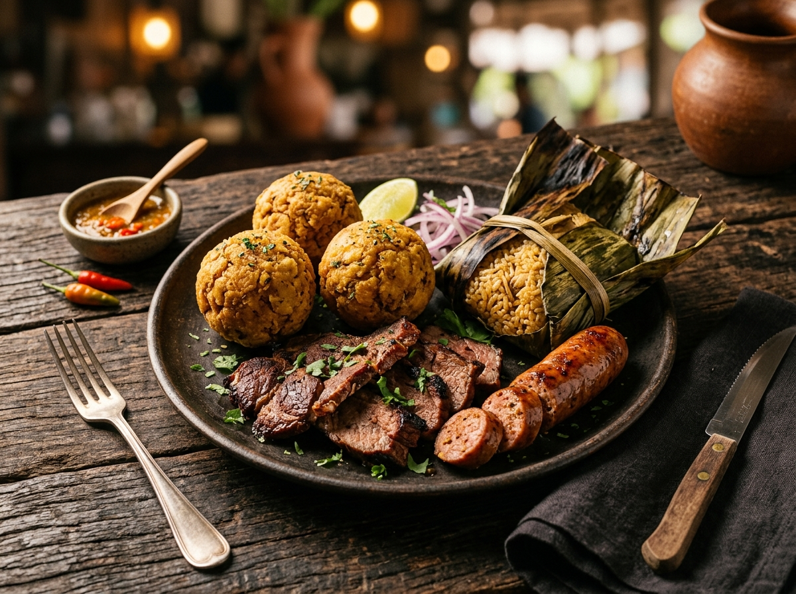
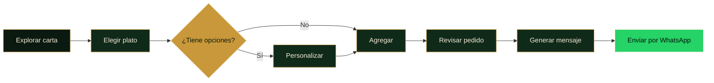
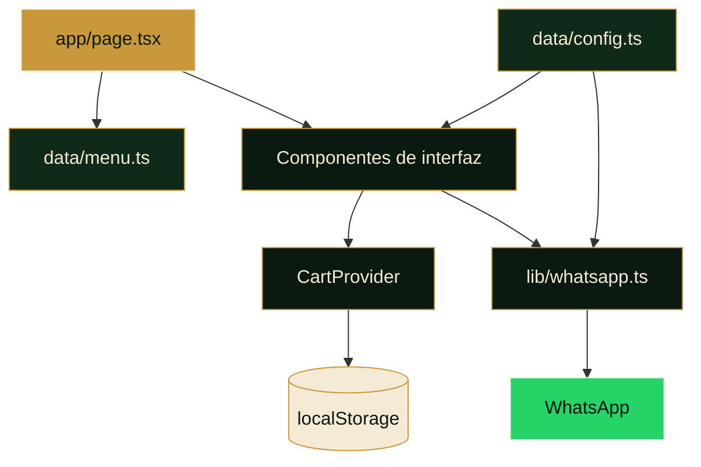

<div align="center">


# LA ESQUINA DEL TUNCHE

### Carta digital · Sabores de la selva y del mar

Una experiencia gastronómica móvil, rápida y envolvente para descubrir cocina
amazónica y marina peruana en Tingo María.

<p>
  
  
  
  
</p>

<p>
  <a href="#-visión">Visión</a> ·
  <a href="#-experiencia">Experiencia</a> ·
  <a href="#-inicio-rápido">Inicio rápido</a> ·
  <a href="#-personalización">Personalización</a> ·
  <a href="#-arquitectura">Arquitectura</a> ·
  <a href="#-despliegue">Despliegue</a>
</p>

</div>

---

<div align="center">
  
</div>

## ✦ Visión

**La Esquina del Tunche** transforma una carta tradicional en una experiencia
digital diseñada para el momento real de consumo: explorar rápido, elegir sin
fricción y enviar un pedido claro por WhatsApp.

El producto combina una estética inspirada en la selva peruana con una interfaz
mobile-first, navegación por categorías, personalización de platos y persistencia
local del pedido.

> [!NOTE]
> La aplicación no necesita backend para operar. El menú, la configuración del
> negocio y la generación del mensaje de pedido viven dentro del proyecto.

## ⚡ Experiencia

<table>
  <tr>
    <td width="50%" valign="top">
      <h3>⌕ Descubrimiento inmediato</h3>
      <p>Búsqueda tolerante a tildes, categorías persistentes y favoritos para llegar antes al plato correcto.</p>
    </td>
    <td width="50%" valign="top">
      <h3>◈ Menú visual</h3>
      <p>Fotografías optimizadas, etiquetas gastronómicas, precios y placeholders temáticos cuando no hay imagen.</p>
    </td>
  </tr>
  <tr>
    <td width="50%" valign="top">
      <h3>＋ Pedido configurable</h3>
      <p>Variantes, extras, notas, cantidades y tipos de pedido reunidos en una experiencia táctil compacta.</p>
    </td>
    <td width="50%" valign="top">
      <h3>↗ Conversión por WhatsApp</h3>
      <p>El carrito construye un mensaje ordenado y listo para enviarse al restaurante, sin formularios externos.</p>
    </td>
  </tr>
  <tr>
    <td width="50%" valign="top">
      <h3>⌁ Persistencia local</h3>
      <p>El pedido se conserva en <code>localStorage</code> para proteger la selección ante recargas accidentales.</p>
    </td>
    <td width="50%" valign="top">
      <h3>◉ Presencia instalable</h3>
      <p>Manifest, metadata social, identidad cromática y experiencia standalone preparada para dispositivos móviles.</p>
    </td>
  </tr>
</table>

### Flujo del pedido



## ⬡ Stack tecnológico

| Capa | Tecnología | Propósito |
|---|---|---|
| Framework | Next.js 16.4 | App Router, optimización de imágenes, metadata y renderizado |
| Interfaz | React 19.3 | Estado, composición de componentes e interacciones |
| Lenguaje | TypeScript 5.9 | Contratos de datos y seguridad estática |
| Estilos | Tailwind CSS 4.3 + CSS | Sistema visual, responsive y animaciones |
| Iconografía | Lucide React | Iconos consistentes y accesibles |
| Tipografía | Cinzel + DM Sans | Personalidad editorial y legibilidad |
| Persistencia | Web Storage API | Conservación local del carrito |
| Conversión | WhatsApp deep link | Entrega del pedido al restaurante |

## 🚀 Inicio rápido

### Requisitos

- Node.js `20.9.0` o superior.
- npm incluido con Node.js.

### Instalación

```bash
git clone https://github.com/reinerjh-png/esquinadeltunche.git
cd esquinadeltunche
npm install
npm run dev
```

Abre [http://localhost:3000](http://localhost:3000).

### Comandos disponibles

| Comando | Acción |
|---|---|
| `npm run dev` | Inicia el entorno local con Webpack |
| `npm run lint` | Ejecuta las reglas de ESLint y Next.js |
| `npx tsc --noEmit` | Verifica los tipos sin generar archivos |
| `npm run build` | Genera la compilación optimizada |
| `npm run start` | Sirve la compilación de producción |

## 🎛 Personalización

La carta está diseñada para actualizarse sin modificar la lógica de la interfaz.

### Información del negocio

Edita [`data/config.ts`](./data/config.ts):

```ts
export const config = {
  name: "La Esquina del Tunche",
  slogan: "Sabores de la selva y del mar",
  whatsapp: "51977480721",
  whatsappDisplay: "+51 977 480 721",
  address: "Dirección del restaurante",
  schedule: "Horario de atención",
  // ...
};
```

| Propiedad | Uso |
|---|---|
| `whatsapp` | Número internacional sin `+`, espacios ni guiones |
| `whatsappDisplay` | Formato legible mostrado en la interfaz |
| `address` | Dirección pública del restaurante |
| `mapsUrl` | Enlace para abrir la ubicación |
| `mapsEmbedUrl` | URL del mapa embebido |
| `schedule` | Horario de atención |
| `social` | Enlaces de Facebook, TikTok e Instagram |
| `featured` | IDs que aparecen en el carrusel de favoritos |

> [!IMPORTANT]
> Sustituye los valores `TODO` de dirección y horario antes de publicar.

### Platos y categorías

El catálogo vive en [`data/menu.ts`](./data/menu.ts). Cada plato sigue este
contrato base:

```ts
{
  id: "ceviche-del-tunche",
  name: "Ceviche del Tunche",
  description: "Descripción del plato",
  price: 30,
  image: "/img/dishes/ceviche-del-tunche.jpg",
  tags: ["recomendado", "marino"],
  variants: [],
  options: []
}
```

Reglas recomendadas:

1. Usa un `id` único, estable y escrito en kebab-case.
2. Guarda los precios como números, sin símbolo de moneda.
3. Mantén el mismo `id` en la ruta de la fotografía.
4. Usa `variants` para tamaños o presentaciones excluyentes.
5. Usa `options` para extras, puntos de cocción u otras elecciones.

### Imágenes

```text
public/img/
├── logo.webp
├── hero-bg.jpg
└── dishes/
    └── <id-del-plato>.jpg
```

Next.js genera automáticamente variantes AVIF/WebP y entrega el tamaño adecuado
para cada viewport. Si una imagen falta o no puede cargarse, `DishImage` muestra
un fallback visual asociado a la categoría.

## ◇ Arquitectura

```text
tunche-app/
├── app/
│   ├── layout.tsx          # Fuentes, metadata, viewport y providers
│   ├── page.tsx            # Orquestación de búsqueda, navegación y sheets
│   └── globals.css         # Tokens y sistema visual
├── components/
│   ├── Header.tsx          # Navegación, búsqueda y acceso al carrito
│   ├── HeroSection.tsx     # Portada y llamadas a la acción
│   ├── FeaturedCarousel.tsx
│   ├── CategoryNav.tsx
│   ├── MenuSection.tsx
│   ├── DishCard.tsx
│   ├── DishSheet.tsx       # Configuración del plato
│   ├── CartSheet.tsx       # Revisión y envío del pedido
│   ├── MapSection.tsx
│   └── Footer.tsx
├── data/
│   ├── config.ts           # Datos del negocio
│   └── menu.ts             # Catálogo gastronómico
├── lib/
│   ├── cart.tsx            # Estado y persistencia del pedido
│   └── whatsapp.ts         # Formateo de moneda y mensaje final
└── public/
    ├── img/
    └── manifest.json
```

### Mapa de responsabilidades



## ◎ Calidad y rendimiento

- Imágenes responsivas mediante `next/image`.
- Precarga reservada para la imagen principal del hero.
- Lazy loading para imágenes y mapa fuera del foco inmediato.
- Búsqueda normalizada y memoizada.
- Scroll-spy sincronizado con `requestAnimationFrame`.
- Fuentes autohospedadas por `next/font`.
- Targets táctiles de al menos 44 px en acciones principales.
- Soporte para `prefers-reduced-motion`.
- HTML semántico, etiquetas accesibles y foco visible.

Antes de integrar cambios:

```bash
npm run lint
npx tsc --noEmit
npm run build
```

## ▲ Despliegue

### Vercel

1. Importa el repositorio desde el panel de Vercel.
2. Conserva el preset detectado de Next.js.
3. No agregues variables de entorno: actualmente no son necesarias.
4. Ejecuta el despliegue y valida la URL pública en un dispositivo móvil.

### Lista de control previa a producción

- [ ] Dirección y horario reales configurados.
- [ ] Número de WhatsApp verificado.
- [ ] Enlaces sociales comprobados.
- [ ] Fotografías optimizadas y correctamente asociadas.
- [ ] Precios y opciones revisados.
- [ ] Mapa y enlaces externos funcionales.
- [ ] Pedido de prueba enviado desde Android e iOS.
- [ ] Metadata Open Graph validada.

## QR para la carta

Una vez publicada la aplicación, genera un QR con su URL final. Para impresión,
usa al menos `3 × 3 cm`, alto contraste y un margen libre alrededor del código.

## Autoría

Diseño y desarrollo por **R.DEV** para **La Esquina del Tunche**.

Este repositorio no incluye una licencia de software explícita. Todos los derechos
permanecen reservados a sus autores y propietarios correspondientes.

---

<div align="center">

<strong>La Esquina del Tunche</strong><br />
_Tingo María · Perú_

`SELVA` · `MAR` · `SABOR` · `TECNOLOGÍA`

<sub>Carta digital construida para convertir cada visita en una experiencia.</sub>

</div>
